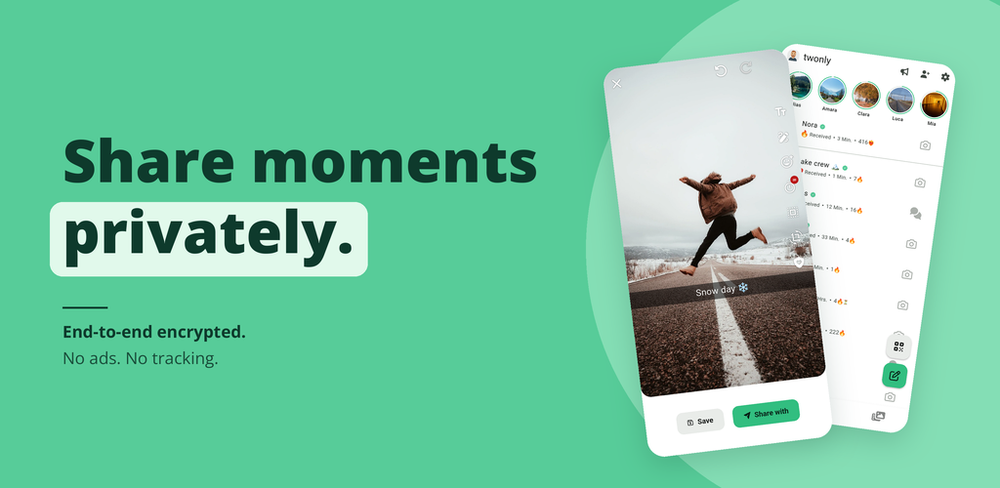
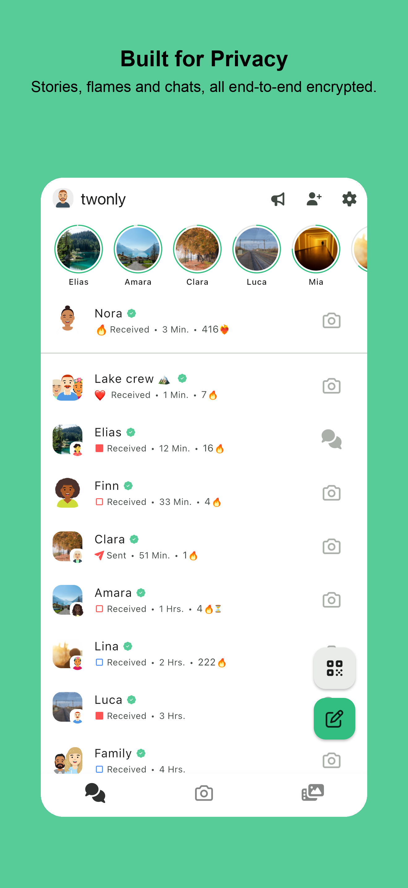
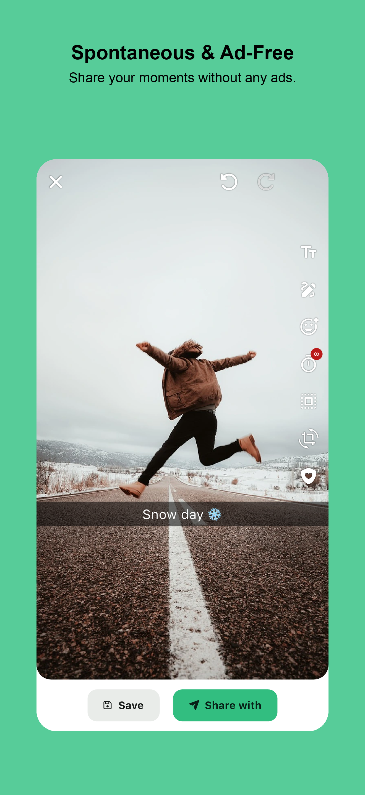
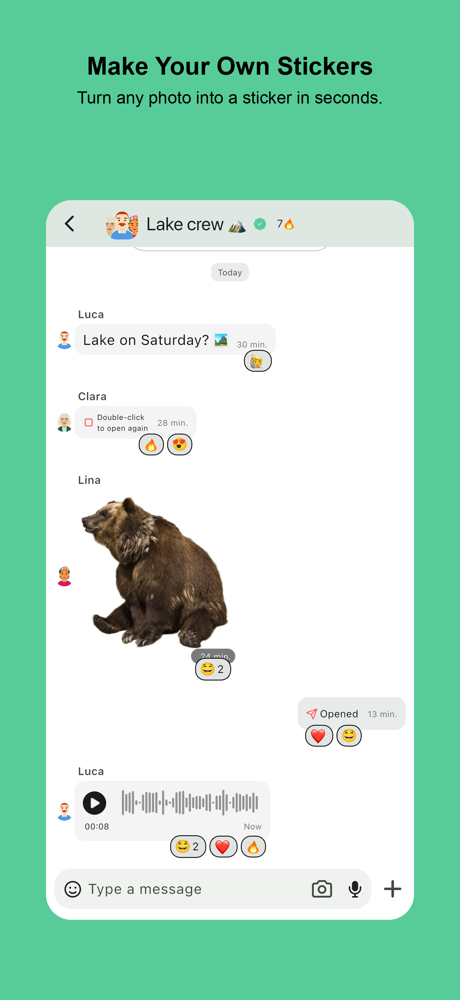
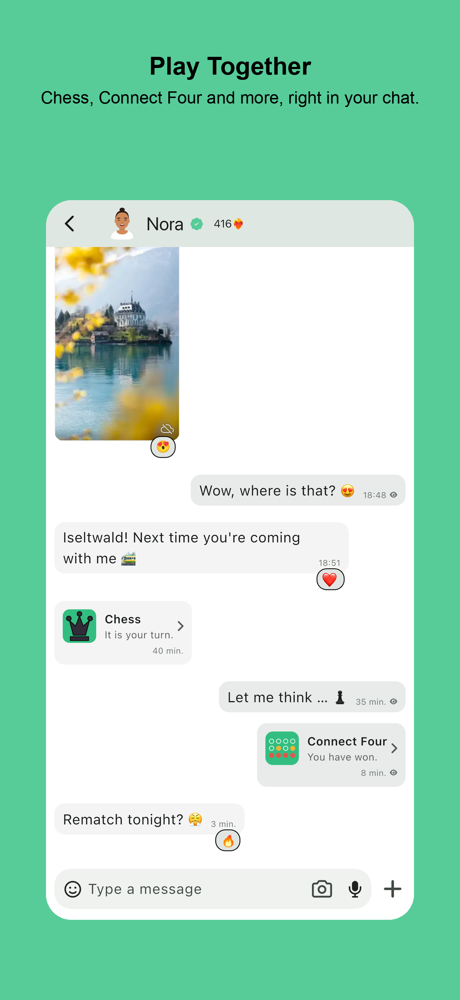
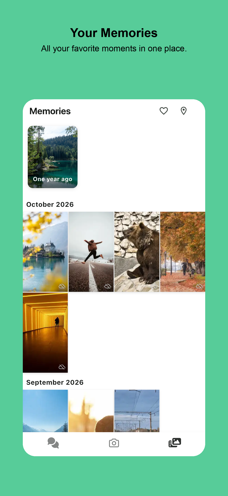

# twonly

[twonly](https://twonly.eu) is an open-source app for sharing photos and videos with friends. I started it because I liked Snapchat's camera and simple photo editor, but wanted end-to-end encryption, European hosting, and no ads, tracking, or forced AI chat.

  
  
  
  
  

    
    
    

twonly is still in its early stages. Features and reliability are being improved, and feedback is welcome.

## Features

- Photo and video sharing with editing tools and viewing timers
- Text and voice messages in one-on-one and group chats
- Live location sharing in chats
- Stories that expire after 24 hours
- Custom stickers and mini-games in chats
- Send photos directly to friends' home screen widgets
- Memories with a map and end-to-end encrypted cloud backups
- End-to-end encryption using the [Signal Protocol](https://signal.org/docs/specifications/pqxdh/)
- No ads, tracking, or data sales
- No email or phone number required to register
- [Account recovery through trusted friends](https://twonly.eu/en/blog/2026-passwordless-backup.html)
- [Privacy-friendly user discovery](https://twonly.eu/en/blog/2026-mutual-friends.html)
- Open source and available directly from GitHub
- Servers hosted exclusively in Europe

## Support the project

Building and maintaining twonly takes time, and there are hosting costs and developer account fees to cover. You can help by spreading the word or subscribing in the app. You can also [donate to the main developer through GitHub Sponsors](https://github.com/sponsors/otsmr).

## Security Issues

If you discover a security issue in twonly, please adhere to the coordinated vulnerability disclosure model. Please send
us your report to security@twonly.eu. We also offer for critical security issues a small bug bounties, but we can not
guarantee a bounty currently :/

## Contribution

Currently there are still some core features and rewrites open I want to do involving a huge rewrite in Rust. Because of this, contributions are currently not wanted. You can still view the code (if you find any security issues please contact me!). Also, issues are currently closed. If you find a bug, please use the in-app option as there you can upload your debug log which helps a lot. 

## Signing Keys

When you download the app **via GitHub or F-Droid** you can verify the signing keys using for example the [AppVerifyer](https://github.com/soupslurpr/AppVerifier) and the following SHA-256 fingerprint of the signing certificate.

eu.twonly
E3:C4:4D:56:8C:67:F9:32:AC:8C:33:90:99:8A:B9:5E:E8:FF:2D:7A:07:3C:24:E3:66:77:93:E6:EA:CD:77:0A

## License
This project is licensed under the [GNU AGPL 3.0](LICENSE) license.
